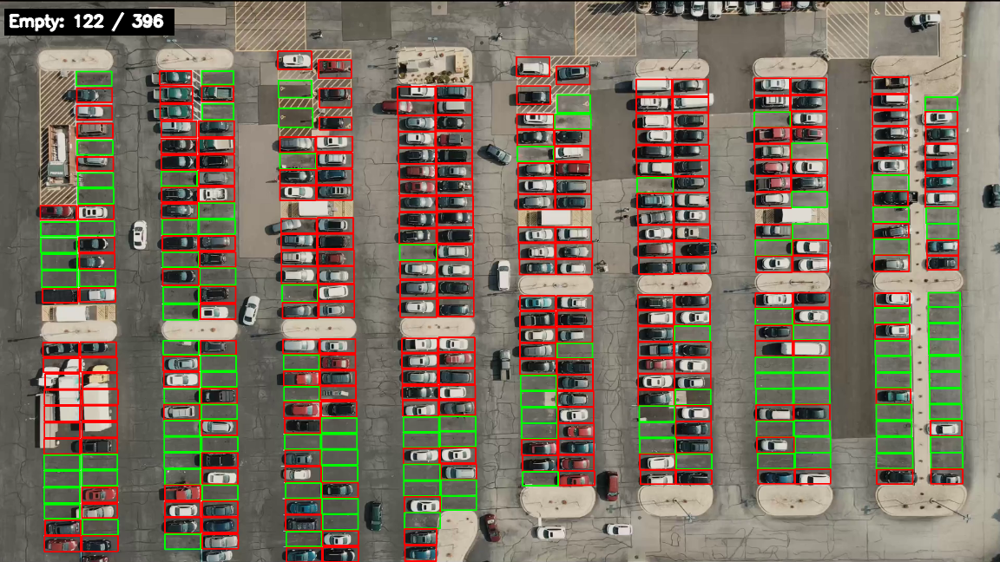
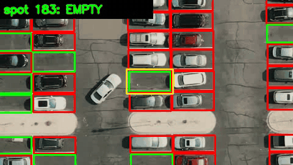
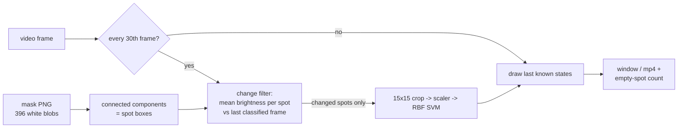
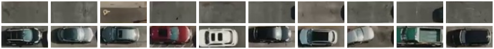

# Parking Spot Detector

Counts free parking spots in fixed-camera video: each of 396 spots is classified empty (green) or occupied (red) by an SVM on a 15x15 crop, and a frame-difference filter skips spots that did not change, cutting model calls about 12x. **94% accuracy on parking slots the model never saw in training.**

[](https://github.com/ParshvCrafts/Parking-Spot-Detector/actions/workflows/tests.yml)




*Output of `detect.py` on the included clip (frame 0).*



*Full-resolution close-up from the same run: a car parks in spot 183 (yellow outline). The label flips at the next classification step, while the car is only partly in.*

## Quick start

```bash
python -m venv venv
venv\Scripts\activate          # macOS/Linux: source venv/bin/activate
pip install -r requirements.txt
python detect.py               # live window, press q to quit
python detect.py --save out.mp4 --frames 300 --no-window   # headless: write annotated video
```

The trained model (`svm_model.pkl`), the 28 s source clip and the labelled crops (`data/`) are in the repo, so detection runs with no download or training step.

## How it works



- **Spots come from a mask, not a detector.** The camera is fixed, so one hand-drawn mask (`mask_1920_1080.png`) gives every spot box via connected components. This turns the problem into 396 small binary classifications instead of object detection.
- **Tiny features on purpose.** Each crop is resized to 15x15 BGR (675 numbers), standardised, and fed to an RBF SVM. Larger crops, HOG and colour statistics were tried and none beat it by more than the fold-to-fold spread (table below).
- **Skip what did not change.** Classifying 396 spots every frame is wasted work: the lot changes slowly. `detect.py` classifies every 30th frame, and only the spots whose mean brightness changed by more than 40% of that step's largest change. Over one pass of the 849-frame clip this made 11.7x fewer model calls than classifying every spot at every step, and matched the classify-everything run on 99.9% of spot-frames (never more than 1 spot off in any frame). The test suite re-checks this on the real clip.

## Results

Evaluated with 5-fold cross-validation **grouped by parking slot**: every test slot is unseen during training and hyperparameter search (`train.py`, nested `StratifiedGroupKFold`).

| Features | Unseen-slot accuracy |
| --- | --- |
| **15x15 pixels (shipped)** | **94.1% ± 4.2%** |
| 30x30 pixels | 94.8% |
| HOG | 93.3% |
| HOG + HSV colour stats | 96.2% |
| 15x15 pixels + edge density | 94.6% |



*Training crops from `data/`: empty (top), occupied (bottom). 1044 empty / 1827 occupied crops from 99 hand-labelled slots.*

Why grouped CV matters: an earlier random image split reported 100%. Each slot contributes ~29 near-identical crops from the same clip, so a random split puts the same slot in train and test and the model only has to recognise it again. Splitting by slot drops the number to an honest 94%.

Misses cluster in about 10 of the 99 labelled slots: cars only partly inside the box, empty spots with painted markings or dark pavement, and spots next to bright cars.

## Pipeline

| Step | Command | Input -> output |
| --- | --- | --- |
| 1. Build dataset (optional, deletes `data/`) | `python crop_cars.py` | clip + hand-labelled slot lists -> `data/empty`, `data/non_empty` |
| 2. Train (optional, overwrites the model) | `python train.py` | `data/` -> `svm_model.pkl` + grouped-CV report |
| 3. Detect | `python detect.py` | clip (looped) + mask + model -> window or `--save` video |
| Tests | `pytest -q tests` | mask spot count, class mapping, change filter vs classify-everything on the real clip |

`utils.py` holds the shared pieces: model loading, `empty_or_not()` (its preprocessing must match training) and `get_parking_spots_bboxes()` (the slot numbers in `crop_cars.py` index this list). `tools/capture_readme_assets.py` regenerates every image in this README, plus the social preview card, from the real detector output (needs `ffmpeg` on PATH).

## Status

Verified:
- Steps 1 to 3 run end to end; step 1 reproduces the committed `data/` byte for byte.
- 94.1% ± 4.2% accuracy on unseen slots of this lot (grouped CV, above).
- Change filter agrees with classifying every spot on >99% of spot-frames (tested in CI on the first 300 frames).

Not verified:
- Other lots, lighting, weather or camera angles. All data comes from one 28 s clip, so treat 94% as an upper bound for new footage. A new camera also needs a new mask.
- Real-time behaviour on live camera input; the detector has only run on the recorded clip.

Next useful step: label a second clip (different time of day) and measure accuracy on it before changing the model.

## Project structure

```
detect.py                   live detector (window or --save mp4)
train.py                    SVM training + slot-grouped evaluation
crop_cars.py                dataset builder
utils.py                    model loading, spot classifier, mask -> boxes
tests/                      pytest suite (runs in GitHub Actions)
tools/                      README asset generator
mask_1920_1080.png          one white blob per parking spot
parking_1920_1080.mp4       28 s source clip
svm_model.pkl               trained model
data/                       labelled crops (empty / non_empty)
plots/                      histograms from tuning the change filter
docs/assets/                README images + social preview
.github/workflows/tests.yml CI: pytest on every push
LICENSE                     MIT
```

## License

[MIT](LICENSE)
